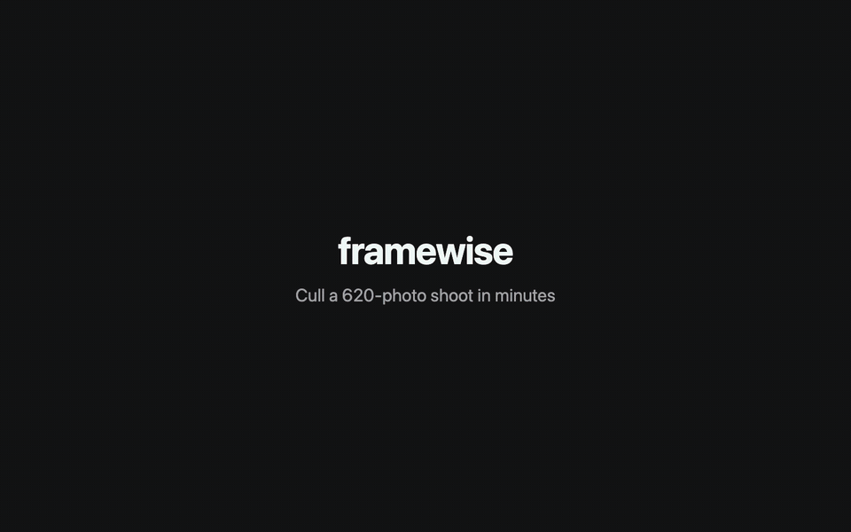

# <picture><source media="(prefers-color-scheme: dark)" srcset="docs/brand/mark-dark.svg" /></picture> framewise

[](https://github.com/acc-aqt/framewise/actions/workflows/ci.yml)
[](LICENSE)

Cull a photo shoot on your own machine: framewise groups bursts and near-duplicates, proposes which Frames to keep and why, and writes your decisions back as ratings for Lightroom Classic.



- [**How it judges**](#how-it-judges): what framewise checks in each Frame.
- [**Reviewing**](#reviewing): the Review UI and its keyboard shortcuts.
- [**Rating write-back**](#rating-write-back): how the result reaches Lightroom Classic.
- [**Providers**](#providers): which analysis runs on which machine, and how to add your own.

Everything runs locally; no photo leaves the machine. Terms such as Frame, Group and Verdict are defined in the [Glossary](GLOSSARY.md).

Built with AI coding agents; design, calibration and review by me.

## Install

The repo has two parts:

- `backend/`: the Python FastAPI backend and the `framewise` command, managed with [`uv`](https://docs.astral.sh/uv/). `uv` installs and pins its own Python, so the system Python is untouched.
- `frontend/`: the Angular Review UI, which the backend serves.

Clone the repo:

```sh
git clone https://github.com/acc-aqt/framewise.git
cd framewise
```

Install the prerequisites yourself:

- [uv](https://docs.astral.sh/uv/getting-started/installation/).
- [Node.js](https://nodejs.org), preferably in the version recorded in [`frontend/.nvmrc`](frontend/.nvmrc). With [nvm](https://github.com/nvm-sh/nvm), `nvm use` in `frontend/` reads it. The setup script warns if your Node.js is a different version.
- On macOS, [Homebrew](https://brew.sh).

Then run the setup script:

```sh
scripts/setup.sh
```

On Windows, run its PowerShell counterpart instead, which installs ExifTool with winget:

```powershell
powershell -ExecutionPolicy Bypass -File scripts\setup.ps1
```

It installs everything else framewise needs, optional tools included, builds the Review UI and installs the backend. `--help` (`-Help` on Windows) says what it does and on which platforms it runs. Re-running it is safe: after pulling new changes, run it again to update framewise.

## Platform support

- **macOS**: the Apple Vision Providers serve every Capability. `aesthetics` needs macOS 15 or later.
- **Linux**: the [portable Providers](#providers) serve `fingerprint`, `face-detection` and `eye-state`. There is no `face-quality` or `aesthetics` Provider for Linux yet.
- **Windows** (preview): x64 only; Windows on ARM is not supported. The portable Providers serve the same Capabilities as on Linux. Windows is tested in CI but not yet checked end to end with Lightroom Classic on a real machine ([ADR-0008](docs/adr/0008-windows-as-a-native-platform.md)).
- The portable Providers also run on macOS 14 or later, which onnxruntime needs.

## Running it

Review a Session:

```sh
cd backend
uv run framewise review /path/to/session-folder
```

This scans the folder, starts the server on `http://127.0.0.1:8765/` and opens the browser straight away. The Review UI shows progress and fills in with Groups as analysis runs, which uses every core.

- Leave out the folder (`uv run framewise review`) to choose it in the Review UI: **Choose Session folder…** opens the Finder folder dialog (on Windows, the Explorer one; on Linux, zenity's). To review another Session, restart framewise.
- framewise scans subfolders too. Put an empty `.framewise-ignore` file in a folder to leave it and everything under it out of the Session.
- Results are kept in the Session store under `~/Library/Application Support/framewise/` (on Windows, `%LOCALAPPDATA%\framewise\`; on Linux, `$XDG_DATA_HOME/framewise/`, by default `~/.local/share/framewise/`), so a re-run only analyzes new or changed Frames. `FRAMEWISE_DATA_DIR` overrides that folder.
- To review from another machine, such as when framewise runs on a headless Linux box, forward the port over SSH (`ssh -L 8765:127.0.0.1:8765 <host>`) and open `http://127.0.0.1:8765/` on your machine.

Options:

- `--port` picks another port.
- `--background` analyzes on a quarter of the cores at background priority, so apps like Lightroom stay responsive.
- `--allow-sleep` lets the machine sleep during analysis. By default framewise keeps it awake until analysis finishes (on Linux, through `systemd-inhibit` where it exists).

If the Review UI has not been built, `framewise review` warns you.

## How it judges

framewise analyzes each Frame's JPG with the installed analysis Providers; which ones a machine gets is under [Platform support](#platform-support).

- **Groups**: near-duplicate and burst Frames are grouped together.
- **Verdicts**: each Frame gets a proposed Verdict (Winner, Keeper, Reject or Unsure) with Reasons, judged from its sharpness, motion blur, exposure and, where an `aesthetics` Provider is available, an aesthetics score.
- **Faces**: in Frames with faces, every face is checked for closed eyes, sharpness and, where a `face-quality` Provider is available, face quality. Sharpness is then judged on the faces rather than the whole image. An open Group and the loupe show a badge on each face.
- **Camera rating**: a rating already on the file, such as in-camera stars, nudges a Frame up a little but never past a technical flaw.
- **Keeper budget**: the slider sets roughly what share of the Session's Frames to keep (40% to start, stored per Session). Each Group's Winner always stays, then the best Frames without flaws become Keepers until the budget is spent. The slider shows how many Keepers result.

The Review UI filters by Verdict and by Reason.

## Reviewing

In an open Group, review with Lightroom Classic's shortcuts. On Windows and Linux, the Review UI names the keys `Ctrl`, `Alt` and `Delete`:

| Key | Action |
| --- | --- |
| `1`–`5`, `0` | Set stars, clear them |
| `6`–`9` | Red, yellow, green, blue color label |
| `P` / `X` / `U` | Keep, reject, clear the Override |
| `W` | Make the current Frame the Group's Winner |
| `⌫` / `Delete` | Move the current Frame to the Trash, after you confirm |
| `←` / `→` | Previous or next Frame |
| `⌥←` / `⌥→` (`Alt+←` / `Alt+→`) | Previous or next Frame in the current Group |
| `E` | Open the loupe |
| `C` | Compare with the Winner |
| `Z` | Zoom between fit and 100% |
| `Esc` | Close |
| `⌘K` (`Ctrl+K`) | Command palette, with every command and its shortcut |

The version next to framewise's name opens **What's new**, the [Changelog](CHANGELOG.md) of what changed in each Release; the command palette lists it too.

Overrides are saved in the Session store as you go ([ADR-0003](docs/adr/0003-overrides.md)). The Keeper budget never changes them, and the Frames you keep count towards it.

To fix wrong grouping in an open Group, split it at a Frame or split off the selected Frames, move a Frame to the previous or next Group, or merge the Group with its neighbor. Fixed Groups are kept on later re-runs ([ADR-0004](docs/adr/0004-group-overrides.md)). **Reset grouping** hands a fixed Group back to framewise's grouping.

To get rid of Frames for good, trash the current Frame, the selected Frames or the whole Group. To trash several junk Groups at once, select them in All Groups with their checkboxes, `⌘`-click (`Ctrl`-click on Windows and Linux) or `Shift`-click, then choose **Trash N Groups** or press `⌫` (`Delete`). framewise asks first, then moves every file of each Frame (RAW, JPG and any `.xmp` sidecar) to the OS Trash and takes the Frame out of the Session. Nothing is deleted outright: restore the files from the Trash and run `framewise review` again to bring a Frame back with its Overrides ([ADR-0006](docs/adr/0006-trashing-frames.md)). Trash before you import into Lightroom, because Lightroom shows trashed Frames it already imported as missing.

## Providers

By default each Capability (`fingerprint`, `face-detection`, `eye-state`, `face-quality`, `aesthetics`) uses its highest-priority Provider available on the machine ([ADR-0005](docs/adr/0005-pluggable-analysis-providers.md)). To choose one yourself, name its Provider id in a `config.toml` in the same folder as the Session store:

```toml
[providers]
eye-state = "apple-vision-eye-state"
```

Capabilities left out keep the default. A Provider that is not installed or not available on the machine is an error, never a silent fallback.

`framewise-benchmark` reads the same file, and `--provider <capability>=<id>`, repeatable, overrides it for one run, so Providers can be compared against your Reference ratings. Its report names the Provider that served each Capability.

The portable Providers run on Linux and macOS with free, local models:

- DINOv2-small, run by onnxruntime, serves `fingerprint` (`dinov2-small-fingerprint`).
- MediaPipe's Face Landmarker serves `face-detection` (`mediapipe-face-detection`) and `eye-state` (`mediapipe-eye-state`).

On Linux the [setup script](#install) installs them. On macOS, install them with the `portable` extra (`cd backend && uv sync --extra portable`); the setup script keeps them when you run it again. They rank below Apple Vision, so on macOS Apple Vision stays the default ([Platform support](#platform-support)).

Their model files are downloaded on first use into a `models` folder next to the Session stores and checked against pinned SHA-256 checksums. On a machine that will analyze offline, fetch them ahead of time with `uv run framewise models download`.

To write your own Provider, such as another face detector or eye-state check, see [docs/providers.md](docs/providers.md).

## Rating write-back

Nothing is written to the photos until you ask ([ADR-0001](docs/adr/0001-frames-jpg-analysis-and-rating-write-back.md)). Write back before importing into Lightroom.

1. Once analysis has finished, **Rating write-back…** in the Review UI shows a dry run: every file with its current and new rating and color label.
2. Only after you confirm does framewise write the Verdicts: Winner 3★, Keeper 2★, Reject 0★ with the red label, Unsure 0★ with the yellow label.
3. **Undo write-back** restores the previous values, which are kept in the Session store, and removes sidecars framewise created.

Details:

- Overrides count: an Override's Verdict replaces framewise's, and stars or a color label set with the shortcuts replace the ones the Verdict maps to.
- JPGs and DNGs get embedded XMP; other RAWs get an `.xmp` sidecar, merged into any existing one.
- Label names come from Lightroom Classic's active color label set (for example `Rot` and `Gelb`), read from its preferences on macOS and, on Windows, from `%APPDATA%\Adobe\Lightroom\Preferences\Lightroom Classic CC 7 Preferences.agprefs`.
- Writing takes a while for large Sessions, because each DNG is rewritten in full. The screen shows how many files are done, and reloading the page doesn't stop it.
- Write-back needs [ExifTool](https://exiftool.org), which the [setup script](#install) installs.

**Reset Session…** on the same screen starts the review over: it undoes the write-back and clears all Overrides, fixed Groups and the Keeper budget. The analysis is kept, so nothing is analyzed again. Stars and labels framewise didn't write, such as in-camera ratings, stay as they are.

For development and demos, `uv run framewise reset /path/to/session-folder` resets harder: it undoes the write-back, then deletes the Session store, so the next `framewise review` analyzes every Frame again. Quit `framewise review` first. If a file can't be restored, the store is kept so you can retry.

## Architecture

The design decisions are recorded as ADRs in [docs/adr/](docs/adr/), and the domain terms in the [Glossary](GLOSSARY.md).

## Tests

Set up the checkout as under [Install](#install), then run from the repo root:

```sh
(cd backend && uv run pytest && uv run ruff check .)
(cd frontend && npx ng test --watch=false)
```

Most backend tests use a fake Frame analyzer. `tests/test_providers.py` composes analysis from fake Providers. `tests/test_apple_vision.py` runs the real Apple Vision Providers on generated images and the public-domain reference faces in `tests/fixtures/faces/`, and is skipped on other platforms. `tests/test_mediapipe_faces.py` runs the MediaPipe Providers on the same faces and `tests/test_dinov2_fingerprint.py` the DINOv2 fingerprint on generated images and a Session analyzed only by portable Providers; both are skipped unless the `portable` extra is installed and `framewise models download` has run.

## License

[MIT](LICENSE). The demo photos in the screenshots are public domain, see [docs/images/](docs/images/README.md).
